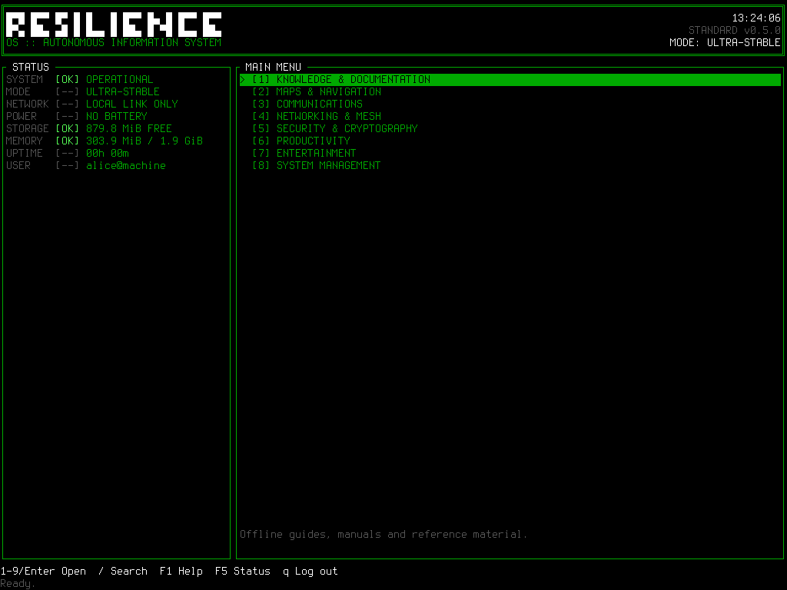
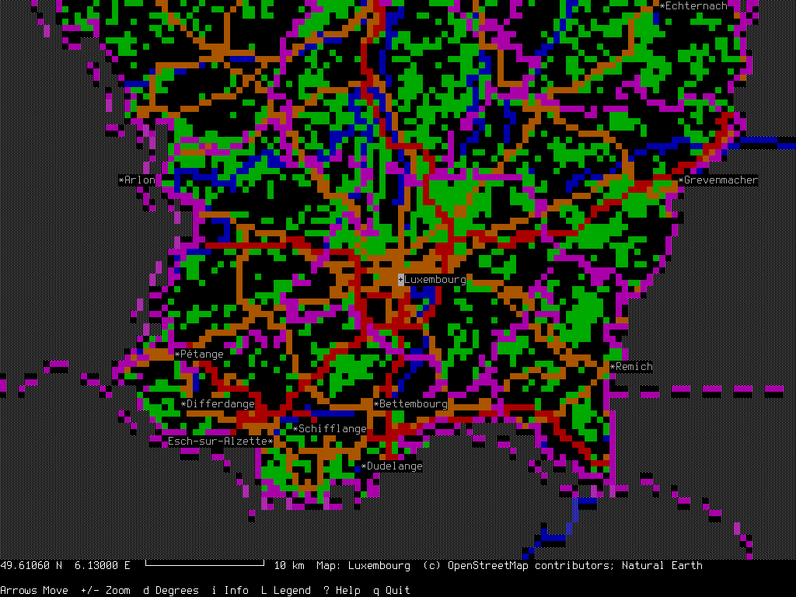
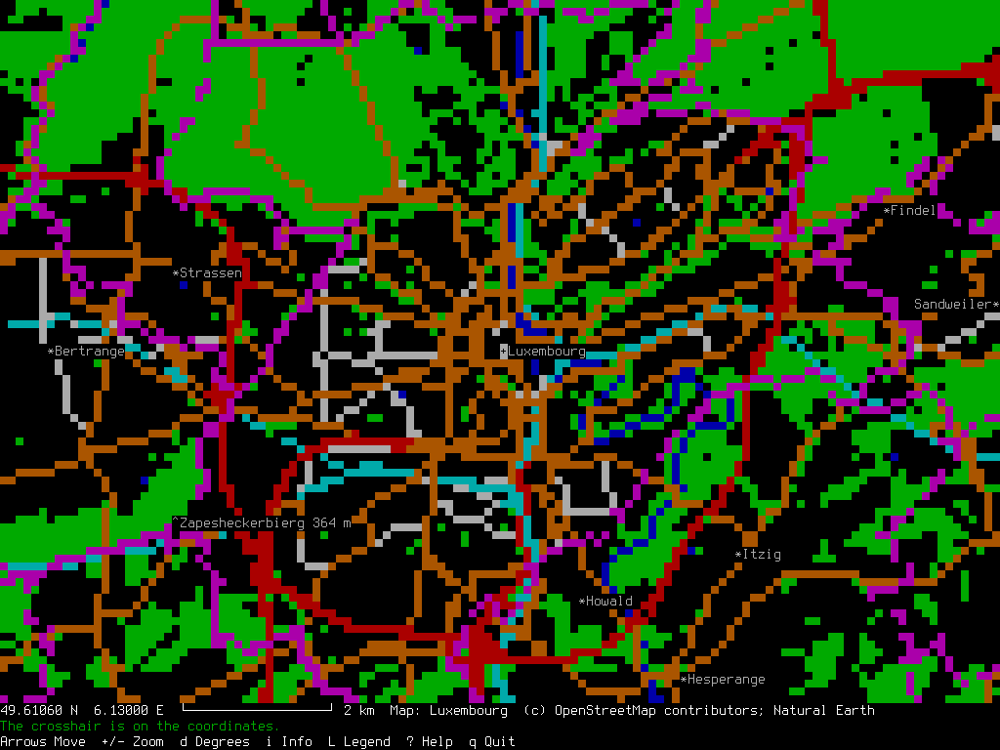
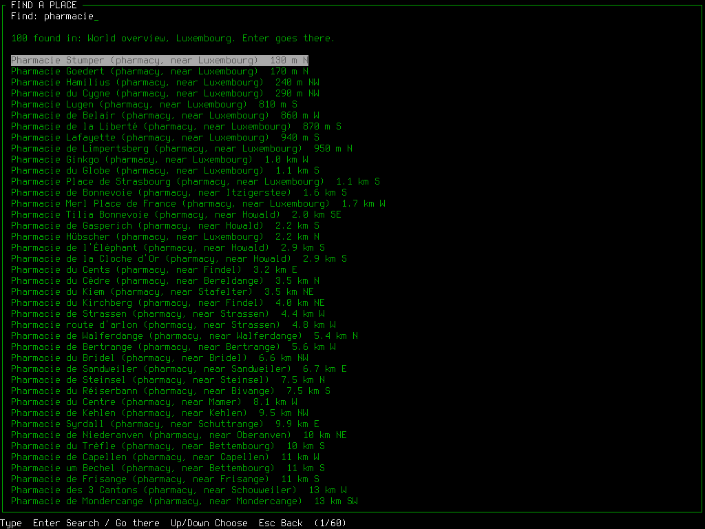

# Resilience OS

**An offline-first, terminal-only operating system for x86_64 PCs, based on NixOS.**

> [!WARNING]
> **A personal project made for fun. Do not rely on it in a real emergency.**
> Most of Resilience (code, tests and documentation) was written by an AI
> (Claude, through Claude Code), directed and reviewed by one person. It has
> not been audited, has run almost only in virtual machines, and nobody
> supports it. If you truly need to stay informed, communicate or keep data
> safe without the Internet, use tools that are maintained and proven for
> that purpose.

Resilience OS is designed to stay useful — information, productivity, local
communication, security tools — during a long or complete loss of Internet
connectivity. It boots straight into a keyboard-driven text interface that
works at 80×24, without colour, and on modest hardware.



<table>
<tr>
<td></td>
<td></td>
</tr>
<tr>
<td colspan="2"></td>
</tr>
</table>

<sub>Real screens of the standard edition in QEMU (1024×768, the system's
console font and its 8 colours), taken with `scripts/update-screenshots.sh`
on 2026-11-20 from the development branch: map search and the Luxembourg
pack come with 0.6.0, not yet released.</sub>

> **Status: early prototype (v0.6.0).** It boots and is usable in a
> virtual machine (x86_64). On physical hardware, the live ISO booted on a
> ThinkPad L15 Gen 1, and release 0.5.0 ran on two laptops (a ThinkPad L15
> and a ThinkPad Yoga 11e: cable, sharing, hotspot, mesh, messages). The
> text installer (whole disk, optional encryption) and signed offline
> updates from a USB stick are tested in virtual machines only. Maps:
> the world overview, two regional packs in the catalog and packs you
> build, with search; radio tools do not exist yet.
> See [ROADMAP.md](ROADMAP.md) and [docs/TESTING.md](docs/TESTING.md) for
> exactly what works.

## What works today

- Bootable live ISO (UEFI and BIOS) that boots into the TUI with no network.
- Main menu, live status panel (system health, mode, network, battery,
  storage, memory), search, context help, four themes including Monochrome.
- Three security modes enforced by the operating system (groups, sudo,
  Nix daemon access) — not by hidden menus. Modes can be changed from the
  interface with an administrator's password; every change is audited and
  survives reboots.
- Recovery section: system health, failed services, earlier system
  generations, exportable diagnostic report, emergency guide.
- Backups & USB sticks: encrypted (age) backups of your home folder on a USB
  stick, checked without the passphrase, restored into a new folder; safe
  eject. Internal disks are never offered.
- Offline handbook, private notes, network diagnostics with an opt-in,
  time-limited Internet probe, system status report, notification history.
- Launcher for verified text-mode programs (editors, file manager,
  calculator, calendar, process monitor, games) with restricted variants for
  beginners.
- Crash recovery: the session restarts the interface; other consoles and
  previous system generations remain available.
- Text installer (whole disk, encryption on by default, accounts and their
  modes, keyboard layout) and offline updates: a signed update on a USB
  stick is checked, installed with an administrator's password, and starts
  at the next restart with the previous version kept in the boot menu.
  Computers installed from 0.3.0 cannot take updates: reinstall them once.
- Local messages between nearby computers without the Internet, with
  store-and-forward and files, and a Wi-Fi mesh when there is no router
  (standard edition).
- Community network: computers nearby share their library, packs, a
  folder and pages; packs from them are checked against the catalog. An
  administrator can share, or turn the computer into a Wi-Fi hotspot.
  Nothing is shared until an administrator turns it on.
- Offline maps: a built-in world overview, regional map packs down to the
  street (Luxembourg and Bretagne in the catalog, others built from
  OpenStreetMap), search by name, places nearby, go to coordinates.

## Downloads

Releases (ISO, offline update, source) are published on GitHub and on
<https://mirror.canevet.eu/files/resilience/>, with a `SHA256SUMS` file
signed with minisign. Check a download as explained in
[keys/README.md](keys/README.md) before using it.

## Quick start (developers)

Requires Nix with flakes; no root access is needed.

```sh
nix develop                  # Rust + Nix tooling
cargo test                   # Rust unit and interface tests
nix run .#vm                 # boot a development VM in the terminal
nix build .#iso              # build the live ISO (large, slow)
```

See [docs/BUILDING.md](docs/BUILDING.md) and [docs/TESTING.md](docs/TESTING.md).

## Documentation

| For | Read |
|---|---|
| Everyone | `handbook/` (also inside the system), [docs/RECOVERY.md](docs/RECOVERY.md), [docs/OFFLINE_OPERATIONS.md](docs/OFFLINE_OPERATIONS.md) |
| Administrators | [docs/INSTALLATION.md](docs/INSTALLATION.md), [docs/ARCHITECTURE.md](docs/ARCHITECTURE.md), [SECURITY.md](SECURITY.md) |
| Contributors | [CONTRIBUTING.md](CONTRIBUTING.md), [CLAUDE.md](CLAUDE.md), [docs/decisions/](docs/decisions/) |

## License

Resilience's own code is licensed under the
[Hippocratic License 2.1](LICENSE), an Ethical Source license: broad
permission to use, change and share it, on the condition that it is used
in a manner consistent with human rights. It is not a free software
license in the FSF/OSI sense. Bundled third-party software keeps its own
license; see [docs/COMPONENTS.md](docs/COMPONENTS.md).
